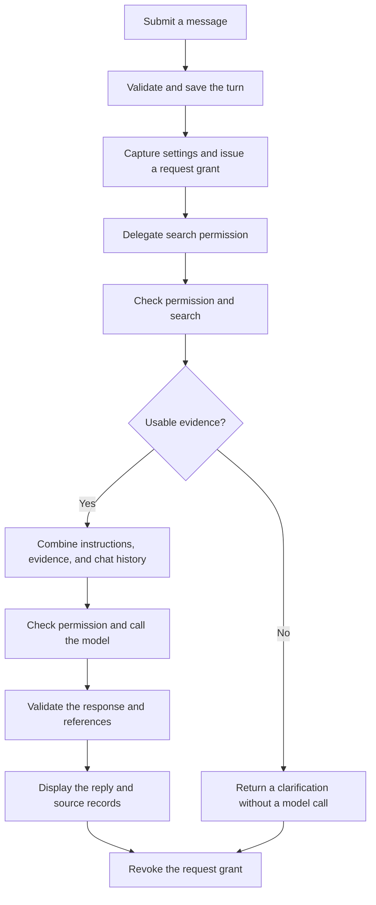

# Learn How Life Direction Agent Works

## v0.5.0 reading route

The current app adds a mainland China graduate workspace. Start with `student_tools.py` for profile validation, skill aliases, and CSV operations; `student_ui.py` for local tools and state; `student_market.py` for researched briefs; and `app.py` for the three views. Existing conversation, evidence, and permission code still supplies the online path.

The walkthrough below preserves the v0.4.0 learning record and its historical test counts. Its optional source-region control has been replaced in the student workspace by explicit China scope. Use the [student career guide](STUDENT_CAREER_GUIDE.md) for current UI steps and [release status](RELEASE_STATUS.md) for current validation evidence.


Follow version 0.4.0 from a message to a reply or checked plan. The exercises use fictional inputs and need no API key. Code, comments, and interface text are in English.

Start with the [project README](../README.md) for installation or the [documentation index](README.md) for other guides.

## 1. Set up a source checkout

Open PowerShell in the folder where you want to keep the project:

```powershell
git clone https://github.com/C1S9/career-planning-assistant.git
Set-Location -LiteralPath '.\career-planning-assistant'
python -m venv .venv
.\.venv\Scripts\python.exe -m pip install -r requirements.txt
.\.venv\Scripts\python.exe -m streamlit run app.py --server.address localhost
```

For an existing checkout, open its folder and reuse its environment. The `.venv` path selects the interpreter without activation. Stop with Ctrl+C. For live requests, connect your own DeepSeek key as described in the README. Keep keys out of commands and screenshots.

The Windows release bundles Python and needs no source setup.

## 2. What the stack does

Pinned dependencies and the recorded v0.4.0 environment:

| Technology | Version or configuration | Role |
| --- | --- | --- |
| Python | 3.15.0 in the verified environment | Application logic |
| Streamlit | 1.66.0 | Chat page, sidebar, forms, session state, themes |
| OpenAI-compatible Python client | 3.35.1 | Sends model requests to DeepSeek |
| DeepSeek | Default model: `deepseek-flash` | Remote search and model inference |
| HTTPX2 | 2.15.1 | HTTP transport for search and model calls |
| Pydantic | 2.14.1 | Parses plan JSON and validates fields and schedules |
| Markdown runtime skills | Three public files | Coaching and planning instructions |
| Tkinter | Bundled Python toolkit | Desktop launcher window |
| PyInstaller | 6.22.3 | Packages Python and frontend assets for Windows |
| unittest, Mock, Streamlit AppTest | Project tests | Offline application and UI checks |
| Git and GitHub Actions | Repository workflow | Source history, checks, release builds |

The Python permission gateway checks whether a tool call may start. The app uses direct calls, without LangChain or LangGraph. Mentors share one backend; they are not independent model agents.

## 3. Find your way around the code

| File | Read it to understand… |
| --- | --- |
| `app.py` | Controls, session state, queued requests, sources, and activity display |
| `agent.py` | Chat validation, search and generation, error handling, and plan correction |
| `permissions.py` | Tool policies, delegated scopes, call limits, expiry, revocation, and audit metadata |
| `evidence.py` | Search requests and primary-source filtering |
| `search_topics.py` | Fixed search vocabulary and optional regions |
| `references.py` | Checks that source IDs and generated URLs match current results |
| `mentors.py` | Five immutable mentor presets |
| `prompts.py` | How shared, mentor, skill, and plan instructions are combined |
| `coaching_skills.py` | Loading selected sections of public Markdown skills |
| `models.py` | Plan fields, schedule rules, and readable output |
| `desktop.py` | Local server, browser launch, and bundled offline self-test |
| `packaging/windows.spec` | Public resources and hidden imports included by PyInstaller |
| `scripts/build_windows.py` | Build, isolated smoke check, manifest, notices, ZIP, and checksum |
| `.streamlit/config.toml` | Native light/dark appearance and public UI settings |
| `.streamlit/secrets.toml.example` | Placeholder format for local private settings |
| `tests/` | Repeatable behavior checks |
| `.github/workflows/` | Automated tests and Windows builds |

The type name `CareerPlan` is retained for compatibility. It now represents an action plan for any selected mentor.

## 4. Follow one message

For this fictional example, select **Learning & skills** and send: “I want to practise Python for 20 minutes each evening.”



Trace `app.py`, `agent.reply`, `agent._research`, `evidence.retrieve_evidence`, and `agent._complete`. Plans also require usable evidence; otherwise generation stops with an error.

Errors also revoke the grant through `finally`. A request identifier prevents an older conversation's reply appearing in a new one.

## 5. Why Streamlit needs session state

Streamlit reruns the page script after many widget interactions. Ordinary variables are recreated; `st.session_state` keeps values for that connected browser session.

Messages, selected mentor, queued requests, session credentials, and audit data live in Python process memory. This is neither model training nor a permanent browser database. Session loss may remove the data.

Find `queued` in `app.py`. Send, plan, and retry actions queue an operation. Consuming that flag prevents unrelated reruns from repeating provider calls. Redrawing messages or changing themes grants no new request permission.

## 6. How a model request is assembled

`agent.py` directs the `openai` client library to DeepSeek at `https://api.deepseek.com`.

Requests contain system instructions and conversation history. Earlier turns must be resent to provide context. The app waits for a complete response without streaming partial text.

The client uses a 60-second timeout, disables automatic SDK retries, and disables redirects and inherited proxy settings. A usable response must contain a choice, the finish reason `stop`, and nonempty text. Provider failures become fixed, readable UI messages instead of raw error details.

Successful transport means a response arrived. Advice can still be wrong or unsuitable; validators check only the properties described below.

## 7. From a private question to public search topics

`search_topics.py` selects fixed topics using keyword rules. Try this in the project Python interpreter:

```python
from search_topics import search_topic

messages = [{"role": "user", "content": "I want to practise Python each evening."}]
print(search_topic(messages, "learning"))
# learning programming practice
```

This local function does not search. It adds a region only when selected. Fixed vocabulary keeps full conversations out of queries but limits specificity and language coverage. It is not an anonymization model.

`evidence.py` sends the topic to `https://api.deepseek.com/v1/tools/search` and requests page content. It filters publishers, HTTPS URLs, available content, relevance signals, dates, and duplicates, then keeps bounded excerpts from up to three sources.

The source panel shows app-held records: URL, title, excerpt, retrieval time, and publication date when supplied. `references.py` checks recognizable source markers and generated URLs against these records, without establishing whether every sentence accurately represents its source.

Retrieved pages enter the request as data. They cannot create grants or change tool policies. See [Evidence and skills](EVIDENCE_AND_SKILLS.md) for source coverage and filtering limits.

## 8. What mentors and skills change

`mentors.py` defines five presets with different names, welcome messages, focus areas, and instructions. All use the same configured backend. Changing mentor starts a new conversation.

`coaching_skills.py` loads three public Markdown resources:

- `evidence-informed-coaching`: source use and the distinction between evidence, interpretation, and choice.
- `mentor-decision-workflow`: the selected mentor's consultation sequence.
- `realistic-action-planning`: small tasks with observable completion evidence; included for plans.

Trace `load_skill_instructions` into `prompts.py`. Python must load Markdown for its text to reach the model. Skill text cannot add network access, register tools, or change `PermissionGateway` policies.

## 9. What makes a plan “checked”

A plan contains `summary`, `assumptions`, `duration_days`, and 3–8 `tasks`. Each task has `title`, `action`, `start_day`, `end_day`, `reason`, and `completion_criterion`.

Start with a single fictional task in the Python interpreter:

```python
from models import Task

task = Task(
    title="Try a short exercise",
    action="Write a Python function that adds two numbers.",
    start_day=1,
    end_day=1,
    reason="Practise writing and calling a function.",
    completion_criterion="The function returns 5 when called with 2 and 3.",
)
print(task.start_day)
# 1
```

Change `start_day` to `"1"`: strict validation rejects a string where an integer is required. An `end_day` of `0`, missing fields, or extra fields also fail. This validates one task, not a full plan.

For a complete plan, `CareerPlan` also requires the first task to start on day 1, ordered start days, valid start/end order, and dates within the plan period. Tasks may overlap. `parse_plan` checks that the returned duration equals the user's saved selection, from 1 to 365 days. Reference checks use the retrieved evidence.

A field, schedule, or reference failure allows one correction if a completion remains. It reuses the evidence and permission budget. Connection errors, quota errors, and incomplete output stop immediately. The checked label does not certify suitability or future results.

## 10. How the permission gateway limits calls

The registry contains two tools:

| Tool | Fixed destination | Declared data category |
| --- | --- | --- |
| `web.search` | `https://api.deepseek.com/v1/tools/search` | `public_topic` |
| `model.complete` | `https://api.deepseek.com/chat/completions` | `conversation` |

Before invoking a callback, the gateway checks active ancestry, tool registration, exact destination, declared category, granted scope, remaining shared calls, and a callable operation. The category is an application-supplied label, not automatic content inspection.

An allowed call is reserved under a lock before the callback runs. A transport error still spends that reservation.

| Request | Maximum search starts | Maximum model completions |
| --- | --- | --- |
| Chat | 2 | 1 |
| Checked plan | 2 | 2, including one correction |

A grant lasts at most 600 seconds. These ceilings count transport starts, not money or tokens. A request may use fewer calls.

Research can search; writing and planning scopes can complete model requests. These Python capabilities cannot enlarge their parent's authority. Siblings share its remaining allowance; descendants inherit expiry and revocation. Plans use chat's writing boundary; `planner` is an available gateway role.

**Permissions** lets the user pause online requests or lower the search and plan-completion allowances. A pause takes effect when Streamlit processes it. A reserved call may still finish and incur charges; revocation does not cancel or undo it.

See [Permissions and execution boundaries](PERMISSIONS.md) for rules and an offline exercise.

## 11. Read activity records with their limits in mind

**Recent activity** shows request counts and audit metadata. Up to 200 events are kept in conversation memory. **New Conversation** and mentor changes clear them.

Events record request, time, role, tool, resource alias, declared category, outcome, and reason. They exclude payloads, queries, keys, source content, and raw exceptions. A denial reason can show that a call budget ran out.

The audit is temporary and is not signed or tamper-proof. The gateway checks the app's two network transports; it cannot confine arbitrary Python code or serve as a Windows sandbox. No email, arbitrary upload, payment, deletion, or tool-administration transport is registered. Describing such an action in chat does not execute it.

## 12. Where credentials and conversation data go

Credential precedence is: pasted session key, then private process environment settings, then local private Streamlit settings. After a pasted key moves to session memory, its password input clears. The app does not save that pasted key to disk.

DeepSeek receives conversation context for completion and a general topic and optional region for search. Both use the API key; local session storage does not make inference offline.

`.gitignore` and the package's explicit public-file allowlist exclude real settings, environment folders, and private learner context. When preparing a release, inspect the staged files and finished archive as well as the ignore rules.

## 13. Run the offline checks

```powershell
.\.venv\Scripts\python.exe -m unittest discover -s tests -v
```

Mocked transports make success and failure cases repeatable without provider charges. Permission tests check that denied callbacks never start, shared budgets cannot be multiplied, destinations stay fixed, and descendants inherit expiry and revocation. UI tests check user actions and queued request state.

`desktop.permission_self_test` uses local callbacks to exercise an allowed action, an exhausted completion allowance, inherited revocation, and paused-network denial. It needs no key.

Offline tests do not establish current account access, model availability, search quality, or advice quality. Use fictional contexts for live checks and record results separately. CI and release reports list checks executed for each build.

## 14. Build and understand the Windows package

```powershell
.\.venv\Scripts\python.exe -m pip install -r requirements-build.txt
.\.venv\Scripts\python.exe scripts/build_windows.py
```

The Tkinter launcher starts a child server on `127.0.0.1`, waits until it is ready, and opens the browser. Closing the launcher stops its server. The package includes Python, dependencies, Streamlit frontend assets, application modules including `permissions.py`, and runtime skills. Model weights and API access are not included.

The build tests the executable with external Python removed from PATH, then writes a manifest, dependency notices, ZIP, SHA-256 checksum, and report. Keep `_internal` beside the extracted executable. The package is unsigned.

## 15. How GitHub automation fits in

Pushes to `main` and pull requests trigger offline checks. A matching version tag tests and builds Windows, runs the bundled self-test, and publishes a new release if absent. `VERSION`, `version.py`, Windows version resources, and the tag must agree.

GitHub Actions runs on repository events; it does not watch or commit local edits. The desktop app has no background updater. To install a new version, download its release ZIP.

## 16. Choose a reading exercise

1. Compare two presets in `mentors.py`.
2. Try the task example; find the whole-plan checks in `models.py`.
3. Trace `app.py` to `agent.reply`. Find where `queued` is consumed.
4. Run the permissions guide's callback exercise. Find the check that prevents the denied operation.
5. Follow gateway calls in `evidence.py` and `agent._complete`.
6. Follow a source record through prompts, model requests, reference checks, and the UI.
7. Compare a successful-request test with a denial test. What does each assertion prove?
8. Trace `desktop.py` and the build files to understand packaging.

Distinguish code-enforced rules, prompt instructions, and human judgment. Code can reject a task ending after the selected period; it cannot decide whether that task fits the person's life.
