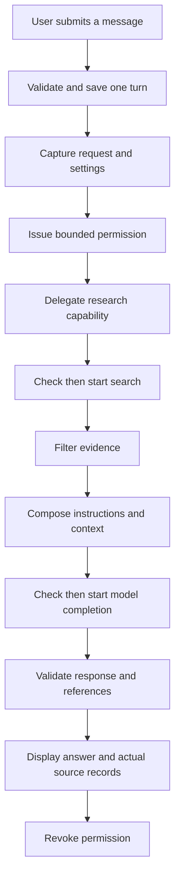

# Build and Understand Life Direction Agent

Version 0.4.0 learning guide. Project code, UI descriptions, and comments use English. This guide describes the implemented application, including the permission gateway; historical first-demo instructions are not current feature evidence.

## 1. The stack and its responsibilities

| Technology | Pinned or observed version | Responsibility |
| --- | --- | --- |
| Python | 3.15.0 in the verified environment | Application and orchestration code |
| Streamlit | 1.66.0 | Chat page, sidebar controls, forms, session state, themes |
| OpenAI-compatible Python client | 3.35.1 | DeepSeek model transport |
| DeepSeek | Configured model defaults to `deepseek-flash` | Remote search and language-model inference |
| HTTPX2 | 2.15.1 | Explicit search transport and model HTTP client |
| Pydantic | 2.14.1 | Strict task fields, JSON parsing, schedule checks |
| Markdown runtime skills | Three public files | Coaching and planning instructions loaded by Python |
| Tkinter | Bundled Python toolkit | Desktop launcher window |
| PyInstaller | 6.22.3 | Portable Windows package with Python and frontend assets |
| unittest, Mock, Streamlit AppTest | Project tests | Offline application and UI checks |
| Git and GitHub Actions | Repository workflow | Source history, checks, tagged release builds |

The permission gateway is local Python code, not a new framework or a trained model. It adds checks before existing tool execution. The project does not use LangChain or LangGraph, and does not create a team of independent model agents.

## 2. Set up and run the source

Use the existing project environment if it is already configured. Do not paste secrets into commands or public screenshots.

```powershell
Set-Location -LiteralPath 'D:\layerdesign'
.\.venv\Scripts\python.exe --version
.\.venv\Scripts\python.exe -m streamlit run app.py --server.address localhost
```

For a new checkout, create `.venv` and install the pinned direct dependencies:

```powershell
python -m venv .venv
.\.venv\Scripts\python.exe -m pip install -r requirements.txt
```

The explicit `.venv` Python path selects the project interpreter without needing a separate activation command. Stop a source server with Ctrl+C. The desktop release bundles an interpreter and does not need these setup steps.

## 3. Know what each file owns

| File | Responsibility |
| --- | --- |
| `app.py` | Draw controls, retain session state, queue explicit user requests, display sources and audit metadata |
| `agent.py` | Validate chat, orchestrate retrieval and generation, map safe errors, bound plan correction |
| `permissions.py` | Tool policies, delegated capabilities, fixed resources, call reservations, expiry, revocation, audit metadata |
| `evidence.py` | Search transport and primary-source result filtering |
| `search_topics.py` | General search vocabulary and optional region choices |
| `references.py` | Current source-ID and generated URL identity checks |
| `mentors.py` | Five immutable mentor presets |
| `prompts.py` | Compose shared, mentor, skill, and plan instructions |
| `coaching_skills.py` | Load the selected skill sections from public Markdown files |
| `models.py` | Strict plan data, schedule validation, readable plan formatting |
| `desktop.py` | Own a loopback server and browser launch; run the offline bundled self-test |
| `packaging/windows.spec` | Explicit public resources and hidden imports for PyInstaller |
| `scripts/build_windows.py` | Build, isolated smoke check, source manifest, notices, ZIP, checksum |
| `.streamlit/config.toml` | Native light/dark appearance and public UI settings |
| `.streamlit/secrets.toml.example` | Placeholder private-setting format, never a real key |
| `tests/` | Reproducible application behavior checks |
| `.github/workflows/` | Test and Windows-release automation |

The internal model name `CareerPlan` remains for compatibility. Its output is a general action plan for the selected mentor.

## 4. Trace one message



Read the real path in `app.py`, `agent.reply`, `agent._research`, `evidence.retrieve_evidence`, and `agent._complete`. An evidence failure returns a clarification instead of pretending the application researched a recommendation. Plan generation requires usable evidence.

A request grant is revoked in a `finally` block, so errors cannot leave authority intended for a completed turn available. UI request identifiers separately prevent an older result from entering a new conversation.

## 5. Streamlit reruns and session memory

Streamlit can execute the page script again after a widget interaction. Normal Python variables are recreated; `st.session_state` keeps values across these executions for that connected browser session.

Messages, selected mentor, queued request state, credentials pasted for this session, and audit data live in Python process memory associated with the session. This is neither model training nor a permanent browser database. Session loss may remove the data.

The application grants a request only after an explicit send, plan, or retry. Rendering saved messages, changing a theme, or redrawing controls does not authorize a new provider request. A consumed queue flag prevents unrelated reruns from repeating the operation.

## 6. Understand the model call

`agent.py` sets the OpenAI-compatible client destination to `https://api.deepseek.com`; the library name does not choose the provider. The request includes system instructions plus the actual conversation history. Prior turns must be sent again for the model to use that context.

The client has a 60-second timeout, disables automatic SDK retries, disables redirect following and inherited proxy settings, and waits for a complete response. The response must have a choice, a completed finish reason, and nonempty text. Provider details are mapped into safe, fixed UI messages rather than displayed verbatim.

Generated text is untrusted output. It can be incomplete, factually wrong, or personally unsuitable even after a successful HTTP response. Validation checks only the properties implemented by the validators.

## 7. Search, evidence, and citations

`search_topics.py` chooses a fixed general topic from limited keyword rules. It avoids copying the full conversation into a query. This privacy choice also limits specificity and multilingual coverage; it is not an anonymization model.

Search calls use `https://api.deepseek.com/v1/tools/search` with page content requested. `evidence.py` filters source publishers, HTTPS URLs, content availability, relevance signals, dates, duplicates, and bounded excerpts. The application retains up to three sources rather than passing unlimited web content to the model.

The source panel is constructed from application-held records: actual URL, title, excerpt, retrieval time, and publication date if reported. `references.py` rejects recognizable source markers and generated URLs that do not match current records. It does not prove that every sentence accurately represents the cited source.

Returned webpage text remains data. It has no grant-creation or policy-registration interface. The gateway keeps a model-generated destination or authority request from becoming an approved tool operation.

See [Evidence and skills](EVIDENCE_AND_SKILLS.md) for source coverage and its limits.

## 8. Mentor presets and runtime skills

The five mentors share the same configured backend. `mentors.py` changes their name, welcome text, focus, and instructions. Changing mentor starts a new conversation so earlier context is not silently transferred.

`coaching_skills.py` reads three public Markdown resources:

- `evidence-informed-coaching`: honest source use and distinctions between evidence, interpretation, and choice.
- `mentor-decision-workflow`: the selected mentor's consultation sequence.
- `realistic-action-planning`: small tasks with observable completion evidence.

Python must load these files and put their instructions into the request. A file's existence alone does not provide network access, authorization, or a new tool. Skill text cannot change `PermissionGateway` policies.

## 9. The permission gateway

The application registry contains two tools: `web.search` for `public_topic` data at the fixed search endpoint, and `model.complete` for `conversation` data at the fixed model endpoint.

The gateway checks active ancestry, registered tool, exact resource, declared data category, granted scope, remaining shared calls, and callable operation. It reserves a call under a lock before invoking the callback. A transport error still spends the reservation.

Default request ceilings are two searches and one completion for chat; two searches and two completions for a checked plan. The second plan completion is only for a validation correction. A grant expires after at most 600 seconds. These are transport-start limits, not currency spending limits.

Research, writing, and planning capabilities are restricted Python scopes. A delegated scope cannot enlarge its parent or create more shared allowance by creating siblings. Parent expiry and revocation apply to descendants. There are no runtime model workers or approval-model roles in this implementation.

The Permissions controls allow or pause online requests and can lower the search and plan-completion allowances. Recent activity displays the last request counts and recent metadata. Pausing is effective when Streamlit processes the setting; a call already reserved and started may finish and cost money. Revocation is not a cancellation or a rollback mechanism.

See [Permissions and execution boundaries](PERMISSIONS.md) for the complete teaching example and limitations.

## 10. Audit data and trust boundaries

The audit retains at most 200 recent metadata events in conversation memory. New Conversation and mentor changes clear this history. Fixed fields identify the request, time, role, registered tool, resource alias, declared category, outcome, and reason. Payloads, query strings, credentials, source content, and raw exceptions are not stored in these events.

This makes the audit useful for understanding why a call was denied. It is not a durable, signed, or tamper-proof ledger. It cannot protect against malicious Python code that owns the process.

The gateway checks the implemented application transports. It is not a Windows sandbox and does not safely confine arbitrary extensions. No email, arbitrary upload, payment, deletion, or tool-administration transport is registered. Writing a suggestion in chat does not execute those actions.

## 11. Checked plans

A checked plan returns JSON with `summary`, `assumptions`, `duration_days`, and 3–8 `tasks`. Each task has `title`, `action`, `start_day`, `end_day`, `reason`, and `completion_criterion`.

Pydantic strict validation rejects wrong types and missing or extra fields. Application rules require the first task to start on day 1, ordered start dates, valid start/end order, all dates within the selected period, and the exact saved plan duration. Overlap is allowed. Reference validation uses the same retrieved evidence.

A failed field, schedule, or reference check permits one correction. The correction shares both evidence and permission budget. Provider connection errors, quota errors, and incomplete output stop immediately. The checked label certifies these implemented checks, not personal suitability or future results.

## 12. Credentials and data flow

A pasted session key overrides private process environment settings, which override local private Streamlit settings. The password input clears after its value is transferred to session memory. The application does not persist a pasted key to disk.

`.gitignore` and the package's explicit public allowlist keep real settings, environment folders, and private learner context out of public distribution. Release verification should inspect actual staged contents and actual archives, not merely trust ignore patterns.

The model provider receives the conversation. The search provider receives the general topic and optional region. The API key authenticates both services at DeepSeek. Local session storage does not mean offline inference or zero external data transmission.

## 13. Test without provider charges

```powershell
.\.venv\Scripts\python.exe -m unittest discover -s tests -v
```

Mocked transports create repeatable success and failure cases. Permission tests assert that a denied callback never starts, shared budgets cannot be multiplied, fixed resources cannot change, and revocation/expiry are inherited. UI checks verify user actions and request state.

`desktop.permission_self_test` uses plain local callbacks. It checks one allowed action, exhausted completion allowance, inherited revocation, and paused-network denial. It needs no key and does not call DeepSeek.

Offline checks do not verify current account access, model availability, search service quality, or every mentor's advice. Live checks should use fictional contexts and record actual results separately. The current CI run and release report supply the executed check evidence for each build.

## 14. Build the Windows application

```powershell
.\.venv\Scripts\python.exe -m pip install -r requirements-build.txt
.\.venv\Scripts\python.exe scripts/build_windows.py
```

The Tkinter launcher owns a child server listening on `127.0.0.1`, waits for readiness, and opens the browser. Closing the launcher stops the server it created. The desktop package includes Python, dependencies, static frontend files, `permissions.py`, and the runtime skills. It contains no model weights or owner's API subscription.

The build script runs the executable with external Python removed from PATH and writes a manifest, dependency notices, ZIP, SHA-256 checksum, and build report. Keep `_internal` next to the executable after extracting. The package remains unsigned.

## 15. Understand GitHub automation

Pushing source triggers offline checks. A matching version tag runs tests, builds Windows, performs the bundled self-test, and publishes a new release if one does not already exist. `VERSION`, `version.py`, Windows version resources, and the tag must agree.

GitHub Actions does not watch local files or automatically commit your unfinished changes. The desktop application does not download and apply updates in the background. A user installs a new version by downloading its release ZIP.

## 16. A useful reading and exercise order

1. Read `mentors.py` to understand simple data classes and presets.
2. Read `models.py` and validate one valid and one invalid plan locally.
3. Trace a chat submission through `app.py` and `agent.reply`.
4. Read `permissions.py` and run the local callback example in the permissions guide.
5. Trace the actual gateway calls in `evidence.py` and `agent._complete`.
6. Read search topics, references, prompts, and runtime skills together.
7. Read one test for a success path and one test proving a denied side effect never starts.
8. Read `desktop.py` and the build files after the application path is clear.

The most useful question during each exercise is: which property is enforced by executable code, which is only requested from the model, and which is still an assumption? Keeping those three categories separate is the central lesson of the permission update.

