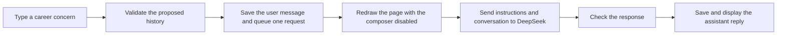
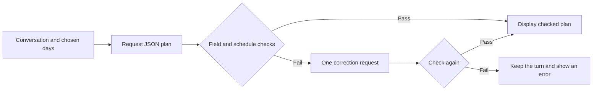

# Build and Understand the Career Planning Assistant

This guide records the actual setup so far and explains the current code. It also walks through the next milestone: one genuine DeepSeek reply. All project descriptions and comments use English, as requested. Explanations in the teaching conversation may remain in Chinese.

## 1. What We Are Building

The goal is a conversational career-planning assistant. A person describes uncertainty about employment and their future. The assistant asks focused questions, learns relevant background, and helps turn the discussion into practical tasks.

The learner selected a chat interface and DeepSeek as the API provider. Education, age context, work situation, and a flexible planning period inform the conversation. The full project is still in progress: a working chat connection comes before independently checked task plans.

## 2. The Process Completed So Far

| Step | What happened | Why it matters |
| --- | --- | --- |
| Prepare the project | Opened `D:\layerdesign` in VS Code | Keeps files and commands in one project |
| Install the curriculum | Installed the official Devpost Learn Skill Pack | Provides the planning and learning sequence |
| Capture the idea | Narrowed life guidance to employment uncertainty and actionable tasks | Gives the prototype a concrete purpose |
| Write planning drafts | Created `devpost/scope.md`, `prd.md`, and `spec.md` in English | Separates what the project does from how it will work |
| Choose the interaction | Selected conversational input and DeepSeek | Defines the user experience and model service |
| Verify Python | Observed Python 3.15.0 | Identifies the interpreter being used |
| Create an environment | Created `.venv` | Isolates this project's installed libraries |
| Install the page library | Installed and checked Streamlit 1.66.0 | Supplies the local browser interface |
| Install the API client | Installed and checked OpenAI Python client 3.35.1 | Supplies a client compatible with DeepSeek's API |
| Create the first chat code | Added the page, API boundary, instructions, and configuration example | Makes the first runnable chat milestone possible |
| Check behavior | Passed nine tests with simulated model replies | Checks application behavior before using live credentials |
| Add learning support | Added explanatory comments and this guide | Makes the implementation easier to read and repeat |

The nine checks do not verify a real API key, account balance, model availability, or advice quality. The learner has since reported successful live use and supplied a generated plan; a contextual follow-up remains a hands-on checkpoint.

## 3. Understand the Environment Commands

These are the commands already used. You do not need to reinstall packages simply to read this guide.

```powershell
Set-Location -LiteralPath 'D:\layerdesign'
python -m venv .venv
.\.venv\Scripts\python.exe --version
.\.venv\Scripts\python.exe -m pip install streamlit
.\.venv\Scripts\python.exe -m pip install openai
```

- `Set-Location` changes the folder in which commands operate.
- `python -m venv .venv` creates a project environment, including its own Python entry point and package directory. Application code belongs outside `.venv`.
- `.\.venv\Scripts\python.exe` chooses this project's interpreter explicitly. A separate activation command is not needed with this form.
- `-m` asks that interpreter to run an installed module, such as `pip` or `streamlit`.
- `pip install` installs a package into the environment whose Python is running it.
- `requirements.txt` records the package versions verified here so another person can reproduce the direct dependencies.

The package is named `openai`, but `agent.py` configures its destination as DeepSeek. The provider is selected by the endpoint and credentials, not merely the package name. See the [DeepSeek first-call guide](https://api-docs.deepseek.com/).

## 4. Know What Each File Does

| File | Responsibility | Start reading here |
| --- | --- | --- |
| `app.py` | Draw the page, manage one session, accept messages, and show replies | `new_conversation`, then the top-level page script |
| `agent.py` | Validate requests, call DeepSeek, and check the returned answer | `validate_history`, then `reply` |
| `prompts.py` | Define the local welcome and English model instructions | `WELCOME` and `SYSTEM_PROMPT` |
| `.streamlit/config.toml` | Configure the native light theme | `[theme]` |
| `.streamlit/secrets.toml.example` | Show the private configuration format using a placeholder | The two setting names |
| `.streamlit/secrets.toml` | Hold the real key locally after setup | Edit privately; never share the file |
| `tests/test_chat.py` | Check input limits, request history, provider errors, and usable output | The named test methods |
| `tests/test_ui.py` | Check the page with simulated replies | Context, reset, and retry checks |
| `devpost/checklist.md` | Track unfinished work and actual evidence | The first unchecked slice |

`scope.md`, `prd.md`, and `spec.md` are planning drafts. `learner-profile.md` stores local learning context and is ignored by Git. A document's existence does not mean its plan has been approved or implemented.

## 5. Follow One Message Through the Application



Text version: input -> validation -> session history -> queued request -> DeepSeek -> response checks -> displayed reply.

Read the matching code in this order:

1. In `app.py`, `st.chat_input` returns text only when the person submits it.
2. The `if prompt:` block trims that text and creates a proposed message history. A message is a dictionary containing a `role` and `content`.
3. `validate_history(candidate)` checks the proposed history before a provider request. Invalid text is not appended.
4. The valid user message is saved once. `queued = True` schedules one reply, and `st.rerun()` immediately restarts the page script.
5. On the next run, the page consumes that flag into `request_now`, resets it, redraws the saved history, and disables new input while the final user turn has no reply.
6. The `if request_now and awaiting_reply:` block calls `agent.reply` with a snapshot of the conversation.
7. In `agent.py`, `reply` adds `SYSTEM_PROMPT`, sends the conversation, and checks for a nonempty, complete answer.
8. Back in `app.py`, a successful answer is appended with the `assistant` role. Another rerun displays the updated transcript.

## 6. Understand the Key Ideas in the Comments

### Reruns and session history

Streamlit usually runs the page script again from top to bottom after an interaction. Ordinary variables are created again. `st.session_state` holds this browser session's history across those runs. It is temporary session memory, not a permanent database or model training.

Rendering the history does not send it to the model. A request happens only inside the explicitly queued request block. This distinction avoids extra calls when the page simply redraws.

### Message roles

- `system`: application-owned instructions from `prompts.py`.
- `user`: what the person submitted.
- `assistant`: a previous reply, or the initial local greeting.

DeepSeek needs the prior conversation with each request to use earlier context. Keeping messages in the browser page alone would not give the model that context. See [DeepSeek multi-round conversations](https://api-docs.deepseek.com/guides/multi_round_chat/).

### The request identifier

`request_token` is a randomly generated local identifier. It is not the API key and is not sent as a credential. A reply is saved only if its identifier still belongs to the active conversation. If an older request returns after a new conversation has started, its answer is ignored.

### Safe failure and explicit retry

A failed request leaves the user's message in history. The error is stored separately in `reply_error`, so error text is not sent back as if it were model advice. **Retry Reply** queues another request for the same turn instead of appending another copy of the user message.

Automatic SDK retries are disabled. A timeout or service error therefore does not silently generate another application-level request. An ordinary page rerun also does not retry a failed turn.

### Input checks and response checks

The page checks input before saving it. The reusable API function checks again before sending it, because it may later be called outside the page.

A successful network response is not enough: `reply` also checks that a choice exists, its completion reason is `stop`, and its text is nonempty. A truncated response is not presented as a complete answer.

These checks do not independently validate the career tasks' schedule or usefulness. Structured task-plan checks remain a later milestone.

### Prompting and the agent boundary

`SYSTEM_PROMPT` is instruction text sent to the existing model. Editing it changes guidance for future requests; it does not train a new model. `WELCOME` is local display text and is not evidence of a live connection.

The current milestone is a conversational assistant. It has no external action tools and does not submit applications or execute tasks. The next planned capability is a checked task plan within the conversation.

## 7. Configure DeepSeek on Your Computer

The project includes a placeholder-only example. If the private file has not been created, copy it without overwriting an existing configuration:

```powershell
Set-Location -LiteralPath 'D:\layerdesign'
if (-not (Test-Path -LiteralPath '.streamlit\secrets.toml')) {
    Copy-Item -LiteralPath '.streamlit\secrets.toml.example' -Destination '.streamlit\secrets.toml'
}
```

Open `.streamlit/secrets.toml` in VS Code. Replace only the placeholder value locally, retaining the quotation marks:

```toml
DEEPSEEK_API_KEY = "paste-your-deepseek-key-here"
DEEPSEEK_MODEL = "deepseek-flash"
```

The value shown here is a placeholder, not a working key. Get your actual API key through the [DeepSeek platform](https://platform.deepseek.com/). Check model access and account usage availability there. The app's proposed default model follows the [current official first-call guide](https://api-docs.deepseek.com/).

Save the private file. `.gitignore` excludes it. Keep the real key out of chat messages, screenshots, source code, and the example file.

The `setting` function reads process environment values before Streamlit secrets. If an older environment setting is present, changing the private file will not override it. Investigate configuration precedence without printing a real key.

## 8. Start or Restart the Page

If the previous server is running in the terminal, stop it with Ctrl+C. Then run:

```powershell
Set-Location -LiteralPath 'D:\layerdesign'
.\.venv\Scripts\python.exe -m streamlit run app.py --server.address localhost --server.port 8501
```

Keep that terminal running and open `http://localhost:8501` in your browser. Restarting after creating a new secrets file ensures the settings are loaded.

Expected before a valid key: the welcome is visible and the composer is disabled with a setup message. Expected after configuration is loaded: the composer is available. Availability of the composer alone does not prove that the key is valid; only an actual successful reply proves that request succeeded.

## 9. Verify One Genuine Conversation

Use fictional background for the first test:

> I studied business and have worked in retail for two years. I feel uncertain about my future career direction.

Send that message and observe whether a reply arrives. Then send:

> Based on the education and work experience I just mentioned, what should I explore first?

Inspect whether the answer uses earlier context. Exact model wording varies; relevance is a human check. A waiting indicator, local greeting, or simulated test reply is not sufficient evidence.

Report only whether a reply arrived and what happened. If an error appears, share its visible text without the key. Do not claim live success until the real response has been observed.

## 10. Read a Failure Without Guessing

| Visible behavior | What to check next |
| --- | --- |
| The setup message remains | File name, saved settings, environment precedence, and whether the server was restarted |
| Access denied | Whether the key belongs to the DeepSeek account and has the expected access |
| Account balance message | The account's API usage availability in its own platform |
| Request rejected | The configured model and current official API options |
| Connection or timeout message | Network reachability and service availability; retry explicitly |
| Reply incomplete | Try a shorter request or conversation; the app intentionally rejects truncated output |
| Conversation limit reached | Start a new conversation; old context is not silently removed |

Do not change several settings at once. Record the observed result, change one relevant thing, and try again.

## 11. Small Learning Exercise

After a real conversation works, try one reversible edit: change the local `WELCOME` text in `prompts.py`, save, then select **New Conversation**. The new welcome should appear. The model's behavior is controlled separately by `SYSTEM_PROMPT`.

This exercise is optional and has not yet been performed. It demonstrates the difference between display text and model instructions without adding a new feature.

## 12. Evidence and What Remains

Verified: the project environment, library imports, and nine simulated-response checks covering the API boundary and chat page. The comment update is intended to preserve application behavior; it is followed by the same checks.

The learner has reported browser success and shared a live reply. Still pending: a contextual follow-up in the same conversation, independently checked task plans, formal approval of unreviewed planning details, a Git checkpoint, final review, and submission preparation. The build checklist stays unchecked where evidence is still missing.

## 13. Keep API Keys Local When Using Git
The learner explicitly requested protection against uploading their API key to Git. The current project is not yet a Git repository. The private settings file remains local, and the ignore rules also cover secret-file and environment-file backup names. A test repository containing fictitious data confirmed that normal staging excludes all nine private fixture paths while allowing placeholder examples. The actual key was not printed or copied to outputs. Before any future commit, review the staged file list and diff; do not force-add ignored credential files. See API_KEY_GIT_CHECK.md for the targeted evidence and limits.

## 14. Review the First Shared Live Plan

The learner supplied the application's response to the fictional seven-day career-exploration test. It contained three tasks:

| Task | Schedule | Observable completion evidence |
| --- | --- | --- |
| Identify transferable retail skills and preferences | Days 1-2 | At least eight skills with energizing or draining labels |
| Compare three related job families | Days 3-5 | Notes on requirements, tasks, gaps, and interest |
| Contact someone in a promising direction | Days 6-7 | A conversation or scheduled conversation, plus stated follow-up notes |

Manual review: the plan has three tasks, begins on day 1, and stays within day 7. It references the supplied education and retail experience and states assumptions. The third task's distinction between scheduling a conversation and completing it could be made clearer; software schedule checks will not by themselves resolve that semantic ambiguity.

This evidence comes from the learner's shared application output. It does not mean an automated validator has been added or an independent network trace captured.

Next, keep the same conversation open and send:

```text
Please shorten this plan to 3 days. Keep 3 tasks and use the background I already shared. Make each task achievable within the 3-day period, with clear completion evidence.
```

Check that the assistant retains the earlier business-degree and retail context, changes all timing to days 1-3, and adapts the work rather than merely changing the heading. This demonstrates why earlier messages must be included with each API request. Report the actual result before marking the follow-up complete.

## 15. Add a Checked Planning Workflow

### What the second live result demonstrated

The learner shared the follow-up to the seven-day plan: three smaller tasks on days 1, 2, and 3. It retained the fictional business-degree and retail context. The last task became sending an outreach message, with completion measured by the sent message rather than another person's availability. This is learner-reported evidence of contextual revision.

### The new application action

The chat page now includes **Create a task plan**. First share background in the conversation. Choose **Plan length (days)**, then select **Create checked plan**. The selected number is saved with that request. Changing the number alone does not call the model.

This selection matters: checking a model's schedule against the model's own claimed period would not prove it respected the person's actual choice. The program compares the returned period to the saved selection.

### The code path to read

1. In `app.py`, the plan button checks the selected period and calls `queue_message` with `kind="plan"` and a duration snapshot.
2. The normal queued-request flow calls `agent.generate_plan` for that request kind. Ordinary chat still calls `agent.reply`.
3. `PLAN_SYSTEM_PROMPT` in `prompts.py` asks DeepSeek for JSON: data with named fields that software can inspect. The request includes a JSON schema and example, plus the exact selected duration.
4. `parse_plan` in `models.py` turns the JSON into a Pydantic `CareerPlan`. Pydantic checks the field types and lengths; custom validators check the relationships among dates.
5. If the plan fails these checks, `generate_plan` sends safe rule feedback and requests one correction. A second invalid plan ends with an error. A connection failure or incomplete response stops immediately.
6. `format_plan` makes the validated object readable in the conversation. The page adds application-owned `schedule_checked` metadata and shows **Task fields and schedule checked**.



### What is checked automatically

- Duration is an integer from 1 to 365 days and matches the saved selection.
- There are 3-8 tasks, each with a title, action, reason, completion criterion, and integer start/end days.
- Task text is nonempty after trimming.
- The first task begins on day 1; later tasks are ordered by their start days.
- Every task satisfies `1 <= start_day <= end_day <= duration_days`.
- Parallel tasks are allowed; finishing before the last possible day is allowed.

These rules do not establish that a role is suitable, a vacancy exists, or every task is practical. The visible label describes field and schedule checks only. Ordinary conversation is not given that label.

### Why the correction loop is bounded

A checked-plan click makes one request if the first plan passes and at most two if a structural correction is needed. SDK automatic retries remain disabled. Explicitly pressing **Retry Reply** starts a new user-requested attempt while retaining the previous duration and avoiding a duplicate user message. This is a small, controlled generate-check-correct workflow.

### Verification completed and next learner check

Twenty-two tests passed with simulated provider replies. They cover chat behavior, supported periods including 1 and 365 days, malformed or incomplete plans, task counts, mismatched periods, correction limits, and the UI's request and labeling behavior. Pydantic 2.14.1 was already available; it is now listed directly in requirements.txt.

Next, rerun the page after the update. Keep or re-enter fictional background, expand **Create a task plan**, select 3 days, and choose **Create checked plan**. A successful result should show **Task fields and schedule checked**, with no task outside days 1-3. Report the actual result or visible error. Do not treat the earlier ordinary-chat examples as proof that this new operation succeeded.

No credential file, ignore rule, or real API key was changed for this feature. The existing local-only credential protections remain in place.


## 16. Prepare the Demo for GitHub

The learner requested an upload of the current demo. This authorizes preparing and publishing the current snapshot; it does not mean the upload has already succeeded.

### What has been prepared

The project now has a local Git repository on branch `main`. Twenty specific files were added to the staging area: application code, tests, requirements, placeholder settings, and English documentation. Installed learning tools stay local, with their sources recorded in `skills-lock.json`.

The staging area is Git's proposed next snapshot. Creating it does not upload files. A commit records that snapshot locally; a push sends commits to a remote repository. An ignored file can still exist locally without becoming part of that snapshot.

### Checks before publication

All 22 automated tests passed using simulated replies. A separate check read every staged file and compared it against the local key in memory, without printing the key. No match or long `sk-` literal was found. Git confirmed that the private settings, learner profile, environment files, dependency environment, and installed learning tools are ignored. The staged changes also passed Git's whitespace check.

### Preparation checkpoint

At the initial preparation checkpoint, GitHub account connection, destination selection, and commit identity were pending. The learner subsequently selected a private repository and completed browser authentication. A GitHub noreply address was used for commit identity; no personal email or token was requested in chat.

The ordinary conversational demo has learner-reported live evidence. The newer checked-plan action has automated coverage and now has a learner-reported successful live test. Publication alone does not complete that verification or the Devpost submission.


## 17. Publish and Verify the Private Demo

The learner selected a private repository. The destination is [https://github.com/C1S9/career-planning-assistant](https://github.com/C1S9/career-planning-assistant). The initial verified published snapshot is `8106f8acf888e462187e0bd040fdf702e43d05c5` and contains 20 tracked files.

### What happened during upload

1. Browser login authenticated Git to the learner's GitHub account. The repository was created with private visibility explicitly enabled.
2. Only the reviewed files were committed. The private Streamlit settings, learner profile, local environment, caches, and installed learning tools stayed outside Git.
3. The standard Git push connection was reset twice. The fallback used GitHub's authenticated API: initialize the empty repository, create the reviewed file tree, commit it, and advance `main` without forcing remote history.
4. The uploaded file-tree hash was compared against the reviewed local snapshot. The remote commit object was reconstructed and hash-verified locally. GitHub's returned commit dates omit original timezone offsets, so the import checked candidate canonical representations against the exact commit hash before accepting an object.
5. The original unpublished commit was retained on the local branch `demo-before-api-upload`. The local `main` and `origin/main` were synchronized with the verified uploaded commit.
6. A separate authenticated check confirmed private visibility, the same local and remote commit, and the same 20 file paths. The API key was not printed, written to the upload scripts, or included in the snapshot.

### How to inspect the result

Open the repository while signed in to the owning GitHub account. Look for the private visibility indicator, `README.md`, `app.py`, and the English learning guide. The tracked configuration example contains a placeholder; the real `secrets.toml` is absent.

In the project terminal, `git status` shows pending local changes, and `git log --oneline -3` shows recent commits. A local commit and a remote upload are separate operations; always check the remote result before saying a release was uploaded. The normal `origin` URL remains configured for future Git pushes when network access permits.

This publishes source code. Running the web application still requires the local Python environment and a privately configured DeepSeek key. It does not deploy a hosted app or submit the Devpost entry. The learner subsequently reported a successful live checked-plan test; its full output was not supplied for independent review.

## 18. Record the Live Checked-Plan Result

The learner reported that the three-day checked-plan test succeeded. The full generated plan was not supplied for independent content review. The learner then indicated that the chat functionality is sufficient; no additional chat feature was requested.

The test was meaningful because the plan button exercises a different path from ordinary conversation: it saves the selected period, requests JSON, validates fields and timing, and only then attaches the checked label. The 22 simulated-response tests exercise failure and retry behavior; the learner's live report supplies separate evidence about the real provider path. Neither establishes career suitability.

Open `devpost/app-map.html` in a browser for an offline reference route through three source locations. The reusable practice is to separate generated content from program-enforced constraints and compare output against the person's saved selection. This is a static reference; no interactive code tour or personal learning outcome is claimed.


## 19. Make the Reviewed Repository Public

The owner explicitly requested public visibility for [https://github.com/C1S9/career-planning-assistant](https://github.com/C1S9/career-planning-assistant). Before changing it, the project history and intended files were reviewed again for the configured key and private files. GitHub then confirmed that the existing repository was public. A separate request without authentication retrieved the README, and its Git blob hash matched the reviewed copy. The anonymous REST API quota was exhausted, so the raw-file host was used for this access check.

Making a repository public lets other people read the included source and history. It does not deploy the Streamlit application or provide API access to visitors. The real DeepSeek settings remain local. No license was added by the visibility change; license selection is still pending.

Next submission material: record the working conversation and checked-plan result using fictional information. The official rules call for a demonstration video under three minutes, publicly visible on YouTube or Vimeo, and English submission materials. The learner supplies their own narration and submission answers. No recording or Devpost submission is claimed by this documentation update.


## 20. Add Mentor Presets and Package Version 0.2.0

The learner requested this update after the first demo: multiple consultation mentors, a simpler UI, Git synchronization, versioning, and an exe that removes Python installation and manual deployment from the user journey.

### Follow one selected mentor

The sidebar returns a stable id such as `learning`. `mentors.py` maps it to a welcome, purpose, and specific instruction. `prompts.system_prompt` combines those instructions with shared rules. `agent.reply` sends that system message and the current conversation to DeepSeek. The plan path uses the same mentor and adds the JSON contract. A preset changes instructions; it does not train a model.

Changing the selected mentor calls `new_conversation`, creates a fresh request token, clears the transcript and pending request, and resets the plan period. This prevents a relationship mentor from accidentally receiving an earlier career conversation. An ordinary rerender still consumes no new request permission. The tests exercise both successful and failed prior requests before a switch.

### Separate appearance, credentials, and behavior

The main chat stays readable while the sidebar holds its controls. `.streamlit/config.toml` supplies shared typography and separate light/dark colors. A password field can set a key for this session; the callback clears the entry field and the key never becomes part of model messages or a saved file. Existing private settings remain supported. The packaged app includes only the public theme file, never `secrets.toml`.

### Understand the executable boundary

PyInstaller packages Python and imported libraries with a small launcher. `desktop.py` starts one child server on `127.0.0.1`, opens the default browser, and stops that child when the launcher closes. The ZIP's `_internal` directory is necessary; the exe is not an offline language model. DeepSeek calls still need internet access and an authorized key.

The build script first verifies the actual frozen program with external Python removed from PATH, then includes dependency notices, a source-hash manifest, the portable ZIP, and its checksum. It never copies the whole project directory. Only reviewed source files, public configuration, and required library assets are collected.

### Evidence and release automation

Twenty-nine simulated-response tests passed. One additional real learning-mentor plan used fictional spreadsheet-learning context and returned a validated three-day, three-task plan. The desktop smoke check covered Tk initialization, plan validation, server readiness, a real frontend asset, and UI script execution. These checks have different meanings; none certifies all personal guidance.

The maintainer reviews source and secret exclusions before synchronization. GitHub Actions tests incoming changes; matching version tags build a Windows package and publish a release without overwriting existing release assets. Manual workflow runs produce artifacts. No background process watches the user's files and commits arbitrary edits.
