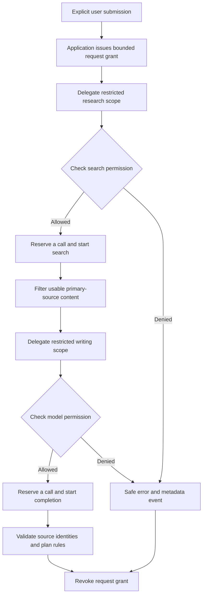

# Permissions and Execution Boundaries

Version 0.4.0 implements authorization in Python around the application's existing search and model transports. A model can suggest actions in its text, but generated text cannot register a tool, mint a request grant, change its limits, or select an arbitrary network destination.

## 1. What is enforced

The current registry contains exactly two tools:

| Layer | Registered tool | Fixed resource | Declared data category | Purpose |
| --- | --- | --- | --- | --- |
| L0: research | `web.search` | `https://api.deepseek.com/v1/tools/search` | `public_topic` | Retrieve primary-source content using a general search topic |
| L1: generation | `model.complete` | `https://api.deepseek.com/chat/completions` | `conversation` | Generate a reply or a structured action plan |
| L2: external actions | None | None | None | Email, arbitrary upload, payment, and deletion remain unavailable |
| L3: administration | None | None | None | Model messages cannot administer grants or register tools |

L0 is still an external network operation: the general query goes to DeepSeek and can incur charges. It is not a promise of local-only data processing. The model API receives conversation context. `data_class` is a program-declared label checked against the registered tool; it is not an automatic content classifier or a guarantee that arbitrary caller-supplied text is anonymous.

The application constructs search terms from a fixed topic vocabulary rather than copying the full chat. Existing source allowlists govern which returned pages may become evidence. The permission gateway constrains the transport destination, while source filtering constrains the evidence publishers. Those are separate checks.

## 2. One submission, one grant

An explicit send, checked-plan action, or retry creates a request scope. Its selected settings and request identifier are captured for that operation. Ordinary Streamlit redraws do not create permission to send another request.

Default application limits are:

| Request | Search starts | Model completions | Maximum grant lifetime |
| --- | --- | --- | --- |
| Chat | 2 | 1 | 600 seconds |
| Checked plan | 2 | 2, including one correction | 600 seconds |
| Paused network | 0 | 0 | No permitted network start |

The Permissions controls can lower search calls per request from two to one and plan model calls from two to one. Chat remains capped at one model completion. Setting the plan allowance to one disables its possible correction because no second completion is authorized. These values are captured for a request; changing the next-request settings does not enlarge an existing grant.

The limits are ceilings, not target counts. Suitable evidence can require fewer searches. A failed search can prevent any model completion. A valid plan uses no correction. There are no hidden application retries after a provider error.

Each allowed operation reserves one call before its transport begins. A timeout or provider error does not refund it. Reservation is protected by a shared lock, so sibling scopes cannot both spend the same last call. Counts are application transport starts, not API token quotas, HTTP packet counts, or a money budget. Provider billing remains independent.

The request grant is revoked in `finally` after success or failure. Expiry is evaluated using a monotonic clock. An explicit retry creates another grant and can incur new charges; it does not reuse the previous request's remaining authority.

## 3. Delegation only narrows authority

`PermissionGateway.delegate` creates a child capability for a registered role:

| Principal | Available role tools |
| --- | --- |
| `orchestrator` | The application's root request tools |
| `research` | `web.search` |
| `writer` | `model.complete` |
| `planner` | `model.complete` |

The orchestrator is issued by trusted application code. A delegated principal cannot become a new orchestrator, add an unregistered tool, or request a limit above its parent's remaining allowance. Child and descendant calls consume the same ancestor budget. Parent revocation and expiry apply to descendants.

These principals describe Python components of the existing workflow. This release does not create a supervisor model, an approval model, autonomous worker conversations, or a multi-agent negotiation system. The `planner` role is supported by the gateway; structured-plan generation uses the model-completion boundary already shared with writing.

## 4. The execution sequence



Before invoking the supplied transport callback, `run` checks:

1. The scope and every ancestor are still active.
2. The tool exists in the immutable application registry.
3. The resource exactly equals that tool's fixed destination.
4. The declared data category matches the tool policy.
5. The scope and every ancestor grant that tool.
6. A shared call allowance remains.
7. The operation is callable.

The implemented HTTP clients disable redirect following and environment proxy inheritance. The model cannot redirect its credentials using a generated URL. These settings do not replace TLS verification, protect a compromised operating system, or prevent trusted Python code from using another transport.

## 5. Pausing and revocation

The Permissions controls let the user pause new network work. Once Streamlit processes that setting, pausing revokes current authority and prevents the next transport from starting. New conversations and mentor changes also invalidate work belonging to the previous conversation. A UI setting is not a synchronous emergency stop for work already running on the server.

Revocation is a future-start boundary. If an HTTP call was already reserved and started, this mechanism does not forcefully terminate its socket, undo provider processing, or prevent charges for that call. Its result may arrive after revocation. Application request identifiers prevent an obsolete conversation result from entering a new conversation.

A grant expires after ten minutes even when budget remains. The gateway has no background scheduler and makes no autonomous calls merely because a permission remains active.

## 6. Audit records

`AuditTrail` stores at most 200 recent events in Python memory associated with the current conversation. **Recent activity** displays them and the last request's counts. **New Conversation** and mentor changes clear this history. The trail returns copies of records to the UI. Each record contains fixed-vocabulary metadata:

- Event and request UUIDs and a UTC timestamp.
- Principal, registered tool, layer, fixed resource alias, and data-category label.
- Status such as `allowed`, `succeeded`, `failed`, `denied`, or `revoked`.
- A fixed reason code such as `budget_exhausted` or `resource_mismatch`.

It does not record API keys, complete conversation text, queries, source excerpts, callback return values, raw rejected resource strings, or raw exception messages. Resource aliases such as `deepseek_model` are used instead of arbitrary input. This prevents a denied malicious string from being copied into audit display.

The audit is a debugging and learning aid. It is not durable storage, a cryptographically signed history, or evidence resistant to a malicious Python administrator. Older events are discarded as the bound is reached, and session loss can remove all records.

## 7. Read and exercise the implementation

Start with `permissions.py`, then inspect `agent._research`, `agent._complete`, the search transport in `evidence.py`, and the request controls in `app.py`.

This local example starts no network operation:

```python
from permissions import MODEL_RESOURCE, PermissionDenied, PermissionGateway

grant = PermissionGateway(search_enabled=False, model_limit=1)
writer = grant.delegate("writer", tools=("model.complete",))

result = writer.run(
    "model.complete",
    resource=MODEL_RESOURCE,
    data_class="conversation",
    operation=lambda: "A local teaching callback, not an API response.",
)

try:
    writer.run(
        "model.complete",
        resource=MODEL_RESOURCE,
        data_class="conversation",
        operation=lambda: "This callback must never start.",
    )
except PermissionDenied as error:
    assert error.reason == "budget_exhausted"
finally:
    grant.revoke()
```

The callback technique makes it possible to test denied side effects without provider credentials or charges. The packaged `desktop.permission_self_test` uses the same approach for budget, inherited revocation, and paused-network checks.

## 8. Limits and future extensions

This is an application execution boundary, not a Windows sandbox. Trusted Python can import modules, access files, or bypass the gateway if new code is written incorrectly. No untrusted plugin execution is supported. The checks depend on keeping network transports behind the gateway; tests exercise those call paths.

The gateway does not prove source accuracy, prevent every prompt injection, inspect all personal information in messages, or guarantee that advice fits a person. Source, reference, plan, and permission checks serve different purposes and must not be conflated.

If a later release adds email or another external action, it needs an explicit tool definition and trusted transport. Approval should bind to an exact reviewed action, including destination, content, validity period, and a stable fingerprint. Changing those inputs must invalidate the approval. No such external-action approval workflow is implemented or simulated as a real capability in v0.4.0.
